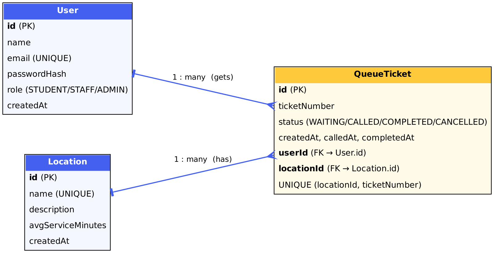
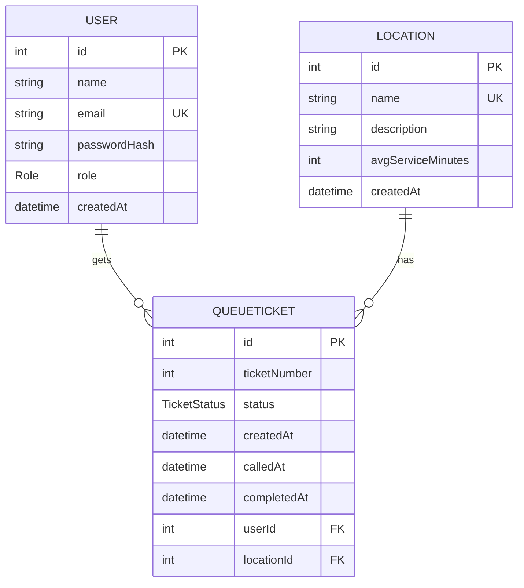

# QueueBee — ER Diagram and Schema (CP2)

**Course:** Advanced Programming (AP) · **Year:** B.Tech 2nd Year · **Team No.:** T0083 · **Section:** D

Files for this checkpoint: `02_er_diagram.mmd` (Mermaid source), `02_er_diagram.png` (picture), `03_schema.sql` (PostgreSQL DDL).

## 1. ER diagram

## 2. Entities

### User — a person who uses QueueBee
| Attribute | Type | Meaning |
|---|---|---|
| **id** | integer, **PK** | Unique number of the user |
| name | text | Full name |
| email | text, **UNIQUE** | Used to log in |
| passwordHash | text | bcrypt hash of the password (never the real password) |
| role | enum `Role` | `STUDENT`, `STAFF` or `ADMIN` (default `STUDENT`) |
| createdAt | timestamp | When the account was created |

### Location — a place where students queue
| Attribute | Type | Meaning |
|---|---|---|
| **id** | integer, **PK** | Unique number of the location |
| name | text, **UNIQUE** | e.g. Canteen, Library Desk |
| description | text, optional | Short description |
| avgServiceMinutes | integer | Average minutes to serve one student (default 5) |
| createdAt | timestamp | When it was added |

### QueueTicket — one student's place in one location's queue
| Attribute | Type | Meaning |
|---|---|---|
| **id** | integer, **PK** | Unique number of the ticket |
| ticketNumber | integer | Running number in that location: 1, 2, 3 … |
| status | enum `TicketStatus` | `WAITING`, `CALLED`, `COMPLETED`, `CANCELLED` (default `WAITING`) |
| createdAt | timestamp | When the student joined |
| calledAt | timestamp, optional | When staff called the ticket |
| completedAt | timestamp, optional | When service finished |
| **userId** | integer, **FK** → `User.id` | Who owns the ticket |
| **locationId** | integer, **FK** → `Location.id` | Which queue it is in |

## 3. Keys and constraints

- **Primary keys:** `User.id`, `Location.id`, `QueueTicket.id`.
- **Foreign keys:** `QueueTicket.userId → User.id` and `QueueTicket.locationId → Location.id`. A ticket cannot exist without a real user and a real location.
- **Unique constraints:** `User.email`, `Location.name`, and the pair `(QueueTicket.locationId, QueueTicket.ticketNumber)` — the same ticket number cannot be given twice in one location.
- **Delete rule:** `ON DELETE CASCADE` — if a user or a location is deleted, its tickets are deleted too.
- **Indexes:** the unique constraints above, plus `(locationId, status)` for fast "waiting tickets of a location" queries. (An optional `userId` index is discussed in CP4.)

## 4. Relationships and cardinality

| Relationship | Cardinality | Explanation |
|---|---|---|
| User → QueueTicket | **1 : many** | One user can have many tickets over time (the app allows only one *active* ticket at a time, which is a rule in the code). |
| Location → QueueTicket | **1 : many** | One location has many tickets. |
| QueueTicket → User | many : **1** | Each ticket belongs to exactly one user. |
| QueueTicket → Location | many : **1** | Each ticket belongs to exactly one location. |

`QueueTicket` is the "many" side of both relationships. Together they mean **User and Location have a many-to-many relationship, and QueueTicket is the table that connects them** (a student can queue at many locations over time, and a location serves many students).

## 5. How the schema matches the Prisma models

| Prisma (`schema.prisma`) | PostgreSQL (`03_schema.sql`) |
|---|---|
| `enum Role`, `enum TicketStatus` | `CREATE TYPE ... AS ENUM` |
| `@id @default(autoincrement())` | `SERIAL PRIMARY KEY` |
| `@unique` on email / name | `CREATE UNIQUE INDEX` |
| `@relation(fields, references, onDelete: Cascade)` | `FOREIGN KEY ... ON DELETE CASCADE` |
| `@@unique([locationId, ticketNumber])` | `UNIQUE INDEX "QueueTicket_locationId_ticketNumber_key"` |
| `@@index([locationId, status])` | `INDEX "QueueTicket_locationId_status_idx"` |
