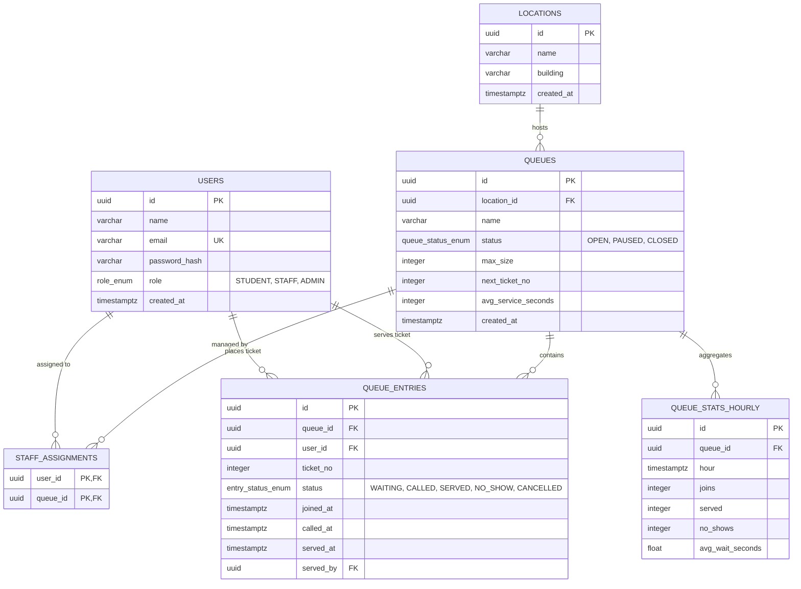

# Smart Queue (QueueBee) — Entity Relationship (ER) Model
**Course:** Advanced Programming (AP) · **Year:** B.Tech 2nd Year  
**Team No.:** T0083 · **Section:** D  
**Group Lead:** Yatharth Soni (2501010531)  
**Checkpoint 2 (CP2) Deliverable**

---

## 1. Visual ER Diagram

---

## 2. Cardinalities & Relationship Descriptions

1. **LOCATIONS to QUEUES (1:N):**
   - One location (e.g., "Main Student Canteen", "Central Library") can have one or more distinct service queues (e.g., "Hot Meals Counter", "Book Issue Desk").
   - Each queue belongs strictly to one physical campus location (`location_id` FK).

2. **USERS to STAFF_ASSIGNMENTS to QUEUES (M:N):**
   - Staff assignments bridge the many-to-many relationship between staff members and counter queues.
   - A staff member can manage multiple queues, and a single queue can have multiple assigned staff operators working in parallel.
   - Enforced by composite primary key `(user_id, queue_id)`.

3. **USERS to QUEUE_ENTRIES (1:N):**
   - A student user creates queue entries over time as they join queues (`user_id` FK).
   - Enforced rule: A partial unique index prevents a student from having multiple active (`WAITING` or `CALLED`) tickets in the same queue simultaneously.

4. **QUEUES to QUEUE_ENTRIES (1:N):**
   - Every ticket entry belongs to a specific queue (`queue_id` FK).
   - Tickets receive a strictly monotonically increasing sequential `ticket_no` allocated safely via PostgreSQL transaction locks.
   - Database constraint `UNIQUE (queue_id, ticket_no)` enforces ticket-number uniqueness per queue.

5. **USERS (Staff) to QUEUE_ENTRIES (1:N, Optional):**
   - `served_by` references the staff user who called and served the student ticket. Allows auditability and staff productivity metrics.

6. **QUEUES to QUEUE_STATS_HOURLY (1:N):**
   - Pre-aggregated hourly summary records for efficient administrative dashboards and high-speed reporting without scanning millions of historical raw entry rows (`queue_id` FK).
